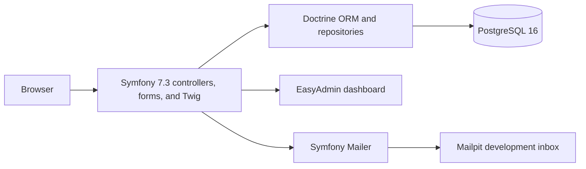

# Medical Appointment Management System

A Symfony web application for managing patient and doctor profiles, doctor availability, and appointments. The French-language interface includes authentication, role-restricted admin and patient areas, appointment booking and cancellation flows, notifications, password reset, and an EasyAdmin dashboard.

This is an academic application prototype. The current code models users, patients, doctors, availability, appointments, contacts, and notifications; it does not include a dedicated medical-record entity. Use synthetic data only and do not deploy it for real patient information without an independent privacy and security review.

## Architecture



The repository also includes a [class diagram](Class-Diagram.png). Docker Compose provides PostgreSQL and, in the development override, Mailpit; it does not containerize the PHP application.

## Technology

- PHP 8.2+
- Symfony 7.3, Twig, Doctrine ORM, and Doctrine Migrations
- PostgreSQL 16
- EasyAdmin, Symfony Security, Forms, Validator, Rate Limiter, and Reset Password bundle
- PHPUnit tests under `tests/`
- Docker Compose for local PostgreSQL and Mailpit services

## Run locally

Prerequisites: PHP 8.2+, Composer, PostgreSQL support, Docker Compose, and the Symfony CLI.

```bash
git clone https://github.com/wejden123cherif/Symfony-Project.git
cd Symfony-Project
composer install
docker compose up -d database mailer
```

The Compose override publishes the database and Mailpit ports on the host. Use `docker compose port database 5432` (and `docker compose port mailer 1025`) to check the mapped ports, then configure `DATABASE_URL` and `MAILER_DSN` in an ignored `.env.local` file for your local environment. Do not commit `.env.local` or reuse development secrets in a deployment.

Apply the database migrations and start the Symfony development server:

```bash
php bin/console doctrine:migrations:migrate
symfony server:start
```

Run the checked-in PHPUnit tests with:

```bash
php bin/phpunit
```

## Security notes

- The checked-in `.env`, `.env.dev`, and `.env.test` files contain development configuration. Keep real application secrets and production database credentials in local, untracked configuration or a secret manager.
- Use synthetic patient data only. The repository does not establish that the application is suitable for handling real health information.
- `docs/SECURITY_MITIGATIONS.md` contains project security notes; it is not an independent security assessment.

## Visual evidence

The repository includes a class diagram but no verified screenshot of a running application. Genuine screenshots of the booking flow, availability management, and admin dashboard with synthetic data would make the project easier to evaluate.
